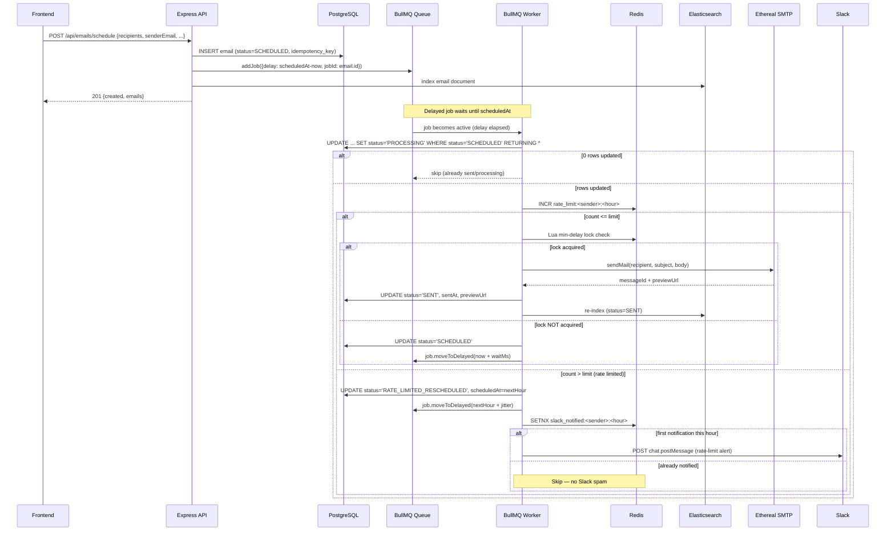
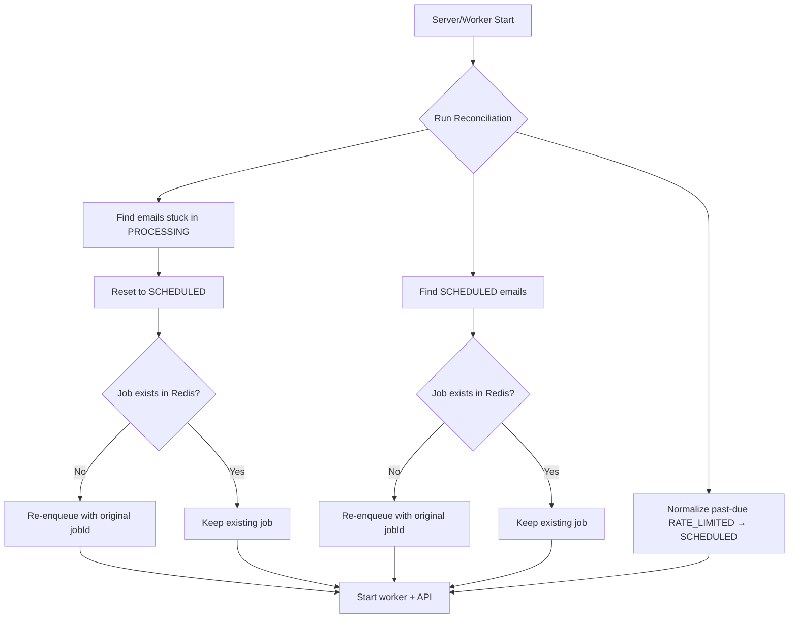

# Outbox — Production-Grade Email Scheduler Service + Dashboard

A ReachInbox-inspired email scheduling platform built with a strict no-cron architecture. Emails are scheduled via BullMQ delayed jobs, persisted in PostgreSQL, rate-limited atomically via Redis, indexed in Elasticsearch, and surfaced in a React dashboard with live Bull Board queue monitoring.

---

## Table of Contents

- [Architecture Overview](#architecture-overview)
- [Tech Stack](#tech-stack)
- [Prerequisites](#prerequisites)
- [Setup Guide](#setup-guide)
  - [1. Start Infrastructure (Docker)](#1-start-infrastructure-docker)
  - [2. Generate Ethereal Email Accounts](#2-generate-ethereal-email-accounts)
  - [3. Configure Google OAuth](#3-configure-google-oauth)
  - [4. Configure Slack OAuth](#4-configure-slack-oauth)
  - [5. Backend Setup](#5-backend-setup)
  - [6. Frontend Setup](#6-frontend-setup)
- [Running the Application](#running-the-application)
- [Core Engineering Guarantees](#core-engineering-guarantees)
- [Engineering Trade-offs & Assumptions](#engineering-trade-offs--assumptions)
- [API Reference](#api-reference)

---

## Architecture Overview

```
┌─────────────────────────────────────────────────────────────────────────────┐
│                              REACT DASHBOARD (Frontend)                       │
│  ┌───────────┐  ┌──────────────┐  ┌──────────┐  ┌──────────────────────┐  │
│  │ Scheduled  │  │ Sent Emails  │  │ Compose  │  │ Elasticsearch Search │  │
│  │ Emails Tab │  │   Table      │  │  Modal   │  │   Bar (Header)        │  │
│  └───────────┘  └──────────────┘  └──────────┘  └──────────────────────┘  │
│         │              │                │                    │              │
└─────────┼──────────────┼────────────────┼────────────────────┼─────────────┘
          │              │                │                    │
          ▼              ▼                ▼                    ▼
┌─────────────────────────────────────────────────────────────────────────────┐
│                         EXPRESS API SERVER (Backend)                         │
│  /api/auth/*    /api/emails/*    /api/slack/*    /api/emails/search          │
│  Google OAuth   Schedule/List    Slack OAuth      ES Full-Text               │
│  + JWT cookie   + Senders        + Alerts                                    │
└───────┬──────────────┬─────────────────────┬────────────────────┬──────────┘
        │              │                     │                    │
        ▼              ▼                     ▼                    ▼
┌──────────────┐ ┌──────────────┐  ┌─────────────────┐  ┌──────────────────┐
│  PostgreSQL  │ │   BullMQ     │  │     Redis       │  │  Elasticsearch   │
│  (Prisma)    │ │   Worker     │  │  (AOF persist)  │  │   Index: emails   │
│              │ │  (concurrency)│ │                 │  │                   │
│  emails table│ │              │  │ rate_limit keys │  │  Full-text search  │
│  users table │ │ ┌──────────┐ │  │ slack_notified  │  │                   │
│  slack integ │ │ │Idempotency│ │  │ sender:last_sent│  │                   │
│              │ │ │  check    │ │  │                 │  │                   │
│              │ │ └──────────┘ │  └─────────────────┘  └──────────────────┘
│              │ │ ┌──────────┐ │         ▲                      ▲
│              │ │ │Rate limit│ │         │                      │
│              │ │ │  check   │ ├─────────┘                      │
│              │ │ └──────────┘ │                                │
│              │ │ ┌──────────┐ │                                │
│              │ │ │Min delay  │ │                                │
│              │ │ │  lock    │ │                                │
│              │ │ └──────────┘ │                                │
│              │ │ ┌──────────┐ │                                │
│              │ │ │Nodemailer │ │──── Ethereal SMTP ────► Preview URL
│              │ │ │  send     │ │                                │
│              │ │ └──────────┘ │                                │
│              │ │ ┌──────────┐ │──── Slack chat.postMessage ────┘
│              │ │ │ES index   │ │     (deduped per sender/hour)
│              │ │ └──────────┘ │
│              │ └──────────────┘ │
└──────────────┘ └────────────────┘
         ▲
         │
┌──────────────────────────────────────────────┐
│     @bull-board/express at /admin/queues      │
│  Live view of active, delayed, waiting,      │
│  completed, and failed jobs                  │
└──────────────────────────────────────────────┘
```

### Scheduling Flow (Mermaid)



### Restart Survival & Reconciliation



---

## Tech Stack

| Layer | Technology |
|-------|-----------|
| **Backend** | Node.js, TypeScript, Express.js |
| **Queue** | BullMQ, ioredis (Redis with AOF persistence) |
| **Database** | PostgreSQL with Prisma ORM |
| **Search** | Elasticsearch `@elastic/elasticsearch` |
| **Email** | Nodemailer (Ethereal Email multi-sender SMTP) |
| **Queue Dashboard** | @bull-board/express at `/admin/queues` |
| **Auth** | Passport.js (Google OAuth 2.0), JWT (HTTP-only cookie) |
| **Frontend** | React (Vite), TypeScript, Tailwind CSS, Lucide Icons |
| **Infra** | Docker Compose (Redis + PostgreSQL + Elasticsearch) |

---

## Prerequisites

- [Docker](https://docs.docker.com/get-docker/) and Docker Compose
- [Node.js](https://nodejs.org/) v18+ and npm
- A Google Cloud project (for OAuth)
- A Slack workspace (for OAuth alerts)

---

## Setup Guide

### 1. Start Infrastructure (Docker)

From the project root:

```bash
docker-compose up -d
```

This starts three containers with healthchecks and named volumes:
- **Redis** on `:6379` with `appendonly yes` persistence
- **PostgreSQL** on `:5432` (user: `outbox`, db: `outbox_scheduler`)
- **Elasticsearch** on `:9200` (single-node, security disabled for local dev)

Verify they're healthy:

```bash
docker-compose ps
```

All three services should show `healthy` status. Named volumes (`redis-data`, `postgres-data`, `es-data`) ensure data survives restarts.

### 2. Generate Ethereal Email Accounts

Ethereal Email provides fake SMTP accounts for testing — all emails are caught and viewable in a browser preview URL (no real delivery).

1. Go to [https://ethereal.email](https://ethereal.email)
2. Click **"Create Ethereal Account"**
3. Repeat this 2–3 times to get multiple sender accounts (the system supports multi-sender rate limiting)
4. For each account, note the: **email**, **user**, **pass**

Configure them in `backend/.env` as a JSON array:

```json
ETHEREAL_ACCOUNTS_JSON=[
  {"email":"test1@ethereal.email","user":"test1","pass":"pass1","host":"smtp.ethereal.email","port":587},
  {"email":"test2@ethereal.email","user":"test2","pass":"pass2","host":"smtp.ethereal.email","port":587}
]
```

> ⚠️ The `pass` value must be URL-safe or properly JSON-escaped. The Ethereal password typically contains special characters — wrap the entire JSON value in quotes and escape any inner quotes.

### 3. Configure Google OAuth

1. Go to the [Google Cloud Console](https://console.cloud.google.com/)
2. Create a new project (or select existing)
3. Navigate to **APIs & Services → Credentials**
4. Click **Create Credentials → OAuth client ID**
5. Set application type to **Web application**
6. Add authorized redirect URI: `http://localhost:4000/api/auth/google/callback`
7. Copy the **Client ID** and **Client Secret**

Set in `backend/.env`:

```
GOOGLE_CLIENT_ID=your-client-id.apps.googleusercontent.com
GOOGLE_CLIENT_SECRET=your-client-secret
GOOGLE_CALLBACK_URL=http://localhost:4000/api/auth/google/callback
```

### 4. Configure Slack OAuth

1. Go to [https://api.slack.com/apps](https://api.slack.com/apps) and create a new app
2. Select **From scratch**, name it, and pick your workspace
3. Go to **OAuth & Permissions → Scopes** and add:
   - `chat:write` — send messages
   - `incoming-webhook` — create webhook
4. Go to **OAuth & Permissions → Redirect URLs** and add: `http://localhost:4000/api/slack/callback`
5. Copy the **Client ID** and **Client Secret** from **Basic Information**

Set in `backend/.env`:

```
SLACK_CLIENT_ID=your-slack-client-id
SLACK_CLIENT_SECRET=your-slack-client-secret
SLACK_REDIRECT_URI=http://localhost:4000/api/slack/callback
```

### 5. Backend Setup

```bash
cd backend
cp .env.example .env
# Edit .env with your Google, Slack, and Ethereal credentials

npm install
npx prisma generate
npx prisma db push    # creates tables from schema.prisma
```

> The `prisma db push` command applies the schema to PostgreSQL without creating migration files. For production, use `npx prisma migrate dev --name init` instead.

### 6. Frontend Setup

```bash
cd frontend
cp .env.example .env
# Edit .env if your API URL differs from localhost:4000

npm install
```

---

## Running the Application

You need three processes running (in separate terminals):

**Terminal 1 — Infrastructure:**
```bash
docker-compose up -d
```

**Terminal 2 — Backend (API + Worker):**
```bash
cd backend
npm run dev
```
This starts the Express API server on `:4000` and the BullMQ worker in the same process (ideal for local development). The startup reconciliation runs automatically.

For production-style separation, run the worker separately:
```bash
# API server only
npm run dev

# Worker only (separate terminal)
npm run worker
```

**Terminal 3 — Frontend:**
```bash
cd frontend
npm run dev
```

The dashboard opens at `http://localhost:5173`.

### Access Points

| URL | Purpose |
|-----|---------|
| `http://localhost:5173` | React dashboard |
| `http://localhost:4000/admin/queues` | Bull Board live queue monitor |
| `http://localhost:4000/api/health` | API health check |
| `http://localhost:9200` | Elasticsearch |

---

## Core Engineering Guarantees

### No Cron Jobs

The system uses **zero** cron-based scheduling — no `node-cron`, no `agenda`, no `setInterval` polling, no OS crontab. All scheduling is handled by BullMQ's delayed-job feature, which stores the job in Redis with a target timestamp and activates it at the exact time.

### Idempotency

Every email has a unique `idempotency_key` (format: `{batchKey}:{recipientEmail}:{senderEmail}`). Before sending, the worker performs an **atomic conditional update** in PostgreSQL:

```sql
UPDATE emails SET status = 'PROCESSING', "updatedAt" = NOW()
WHERE id = $1 AND status = 'SCHEDULED'
RETURNING *;
```

If 0 rows are returned, the job was already processed (or is being processed by another worker) — the worker skips immediately. This prevents duplicate sends even if BullMQ redelivers a job after a crash.

### Restart Survival

- **Redis AOF persistence** (`appendonly yes`, `appendfsync everysec`) ensures delayed jobs survive Redis restarts.
- **PostgreSQL** is the canonical state store — all email records persist across restarts.
- On startup, the reconciliation service:
  1. Finds emails stuck in `PROCESSING` (crashed mid-send), resets them to `SCHEDULED`, and re-enqueues if their Redis job is missing.
  2. Finds all `SCHEDULED` / `RATE_LIMITED_RESCHEDULED` emails and re-enqueues any whose BullMQ job is missing from Redis.
  3. Normalizes past-due `RATE_LIMITED_RESCHEDULED` rows back to `SCHEDULED`.

### Per-Sender Hourly Rate Limiting

Rate limiting uses Redis `INCR` + `EXPIRE` keyed by `rate_limit:<senderEmail>:<YYYY-MM-DD-HH>`:

1. The worker atomically increments the counter for the current hour.
2. If the count exceeds `MAX_EMAILS_PER_HOUR_PER_SENDER`, the job is **never dropped or failed** — instead:
   - The email's `scheduledAt` is updated to the start of the next hour window.
   - The BullMQ job is moved to a delayed state with `job.moveToDelayed(nextTimestamp, token)`.
   - A jitter of 0–60 seconds is added so 1,000 queued jobs don't thundering-herd at `:00:00`.
   - The status becomes `RATE_LIMITED_RESCHEDULED`.
3. The TTL on the Redis key ensures the counter resets automatically at the start of each hour.

### Per-Sender Minimum Delay

A minimum delay between sends is enforced using a **Redis Lua script** that atomically checks and updates `sender:last_sent:<senderEmail>`. The script runs as a single atomic operation so concurrent workers never violate the gap. If the lock isn't acquired, the job is rescheduled with a short delay (the remaining time until the minimum gap is satisfied).

### Slack Alert Deduplication

When a sender hits their hourly limit, only **one** Slack notification is sent per sender per hour window. This uses Redis `SETNX` with the key `slack_notified:<sender>:<hour_window>`. Even if 1,000 jobs are rate-limited in the same hour, only the first triggers a Slack message. If Slack is not connected, the notification is silently skipped with zero errors.

### Elasticsearch Indexing

Every email is indexed in the `emails` index on creation, reschedule, send, and failure. The index uses a `uax_url_email` tokenizer for recipient email fields and `standard` analyzer for subject/body full-text search. The search endpoint `GET /api/emails/search?q=<query>&status=<SCHEDULED|SENT>` performs a `multi_match` query across `recipientEmail`, `subject`, and `body`.

---

## Engineering Trade-offs & Assumptions

### 1. Single-Process API + Worker (Local Dev)

For simplicity in local development, the API server and BullMQ worker run in the same process. In production, these should be separated: the API server handles HTTP requests while dedicated worker processes handle job processing. The `worker-entry.ts` file provides this standalone entry point.

**Trade-off:** Simpler local setup vs. independent scaling. The architecture supports both modes without code changes — just deployment configuration.

### 2. BullMQ `jobId = email.id` (1:1 Mapping)

Setting the BullMQ job's `jobId` to the PostgreSQL email UUID creates a strict 1:1 mapping. This is essential for:
- Restart reconciliation (look up the job by email ID)
- Idempotency (BullMQ deduplicates by jobId)
- Rate-limit rescheduling (`job.moveToDelayed` operates on the known job)

**Trade-off:** BullMQ's `jobId` uniqueness means if you add a job with the same ID twice, BullMQ silently skips it. This is desirable for our idempotency guarantee but means you can't have two jobs for the same email simultaneously.

### 3. Redis as Rate-Limit Source of Truth (Not PostgreSQL)

Hourly rate limits are tracked in Redis, not PostgreSQL, because:
- `INCR` is atomic and O(1) — no row locking needed
- TTL-based expiry automatically resets the counter each hour
- 1,000+ concurrent workers can increment without contention

**Trade-off:** If Redis loses data, the rate limit resets. However, with AOF persistence enabled, this is extremely unlikely. The idempotency check in PostgreSQL prevents duplicate sends even if the rate counter resets.

### 4. Jitter-Based Thundering Herd Prevention

When 1,000 jobs hit the rate limit, they're all rescheduled to the next hour. Without jitter, they would all activate at exactly `:00:00` and overwhelm the SMTP servers. A random 0–60 second jitter spreads them out.

**Trade-off:** Emails in the same batch may arrive up to 60 seconds apart within the next hour. This is acceptable for outreach campaigns and prevents SMTP throttling.

### 5. Elasticsearch as a Secondary Index

Elasticsearch is a secondary index — if it goes down, the primary email pipeline continues. The `indexEmail` function catches errors and logs them without throwing. The search endpoint returns an empty result set (not a 500) if ES is unavailable, so the frontend degrades gracefully.

**Trade-off:** If ES is down during a write, that email won't appear in search until it's re-indexed (on the next status change). This is an acceptable eventual-consistency trade-off for a secondary search index.

### 6. Ethereal Email for Testing (Not Production SMTP)

Ethereal Email captures all emails in a preview-only inbox. This is perfect for development/testing — every sent email has a clickable preview URL. For production, swap `createTransporter` to use a real SMTP provider (SendGrid, SES, Postmark) by changing the sender config. The rest of the pipeline (scheduling, rate limiting, idempotency) works identically.

### 7. JWT in HTTP-Only Cookie

Authentication uses a signed JWT stored in an HTTP-only cookie. This prevents XSS-based token theft. The cookie uses `sameSite: lax` in development and `sameSite: none; secure: true` in production.

**Trade-off:** The frontend can't read the JWT directly (it's HTTP-only). Instead, it calls `GET /api/auth/me` to get the user profile. This adds one API call on page load but is more secure.

### 8. Prisma `$queryRaw` for Atomic Idempotency

The idempotency check uses `prisma.$queryRaw` with a raw SQL `UPDATE ... RETURNING` statement instead of Prisma's generated client methods. This ensures the check-and-set is a single atomic operation at the database level — no race window between a `findUnique` and an `update`.

### 9. Lua Script for Minimum-Delay Lock

The minimum-delay enforcement uses a Redis Lua script (`EVALSHA`) rather than a GET-then-SET pattern. This guarantees atomicity across concurrent workers: the check and update happen in a single Redis command, so two workers can never both pass the check and violate the minimum gap.

### 10. Assumptions for 1,000+ Email Bursts

- **SMTP throughput:** Ethereal Email may rate-limit aggressively. The per-sender hourly limit and minimum delay prevent overwhelming it. For real providers, set `MAX_EMAILS_PER_HOUR_PER_SENDER` to match the provider's limit.
- **Redis memory:** 1,000 delayed BullMQ jobs with their data payloads consume Redis memory. `removeOnComplete: { count: 100 }` and `removeOnFail: { count: 500 }` cap the retained job history.
- **PostgreSQL write throughput:** 1,000 `INSERT` operations are batched per-recipient in the scheduling endpoint. Each insert is a separate query (not a bulk insert) to preserve per-recipient idempotency keys and individual `scheduledAt` timestamps.
- **Elasticsearch indexing:** The `refresh: false` parameter on index operations batches index refreshes for throughput. Search results may be up to 1 second stale (ES default refresh interval).

---

## API Reference

### Authentication

| Method | Endpoint | Description |
|--------|----------|-------------|
| GET | `/api/auth/google` | Redirect to Google OAuth consent |
| GET | `/api/auth/google/callback` | OAuth callback (sets JWT cookie) |
| GET | `/api/auth/me` | Get current user profile |
| POST | `/api/auth/logout` | Clear session cookie |

### Emails

| Method | Endpoint | Description |
|--------|----------|-------------|
| GET | `/api/emails/senders` | List configured Ethereal senders |
| POST | `/api/emails/schedule` | Schedule email(s) |
| GET | `/api/emails?status=<STATUS>&page=1&limit=50` | List emails (comma-separated statuses supported) |
| GET | `/api/emails/counts` | Badge counts by status |
| GET | `/api/emails/search?q=<query>&status=<STATUS>` | Elasticsearch full-text search |

### Slack

| Method | Endpoint | Description |
|--------|----------|-------------|
| GET | `/api/slack/auth` | Redirect to Slack OAuth |
| GET | `/api/slack/callback` | Slack OAuth callback |
| GET | `/api/slack/status` | Check Slack connection status |
| POST | `/api/slack/disconnect` | Remove Slack integration |

### POST /api/emails/schedule

```json
{
  "senderEmail": "test1@ethereal.email",
  "recipients": ["user1@example.com", "user2@example.com"],
  "subject": "Hello from Outbox",
  "body": "This is a test email scheduled via BullMQ.",
  "scheduledAt": "2026-11-24T15:00:00.000Z",
  "hourlyLimit": 100,
  "minDelaySeconds": 2,
  "idempotencyKey": "batch-001"
}
```

**Response:**
```json
{
  "created": 2,
  "emails": [
    { "id": "uuid", "recipientEmail": "user1@example.com", "status": "SCHEDULED" },
    { "id": "uuid", "recipientEmail": "user2@example.com", "status": "SCHEDULED" }
  ],
  "skippedDuplicates": 0
}
```

---

## Environment Variables

### Backend (`backend/.env`)

| Variable | Description | Default |
|----------|-------------|---------|
| `PORT` | API server port | `4000` |
| `DATABASE_URL` | PostgreSQL connection string | — |
| `REDIS_URL` | Redis connection string | `redis://localhost:6379` |
| `ELASTICSEARCH_URL` | Elasticsearch URL | `http://localhost:9200` |
| `GOOGLE_CLIENT_ID` | Google OAuth client ID | — |
| `GOOGLE_CLIENT_SECRET` | Google OAuth client secret | — |
| `GOOGLE_CALLBACK_URL` | Google OAuth redirect URI | — |
| `JWT_SECRET` | JWT signing secret | — |
| `SLACK_CLIENT_ID` | Slack OAuth client ID | — |
| `SLACK_CLIENT_SECRET` | Slack OAuth client secret | — |
| `SLACK_REDIRECT_URI` | Slack OAuth redirect URI | — |
| `ETHEREAL_ACCOUNTS_JSON` | JSON array of Ethereal SMTP accounts | `[]` |
| `WORKER_CONCURRENCY` | BullMQ worker concurrency | `5` |
| `MIN_DELAY_BETWEEN_EMAILS_MS` | Min delay between sends per sender | `2000` |
| `MAX_EMAILS_PER_HOUR_PER_SENDER` | Per-sender hourly rate limit | `100` |

### Frontend (`frontend/.env`)

| Variable | Description | Default |
|----------|-------------|---------|
| `VITE_API_URL` | Backend API URL | `http://localhost:4000` |
| `VITE_BULL_BOARD_URL` | Bull Board dashboard URL | `http://localhost:4000/admin/queues` |
